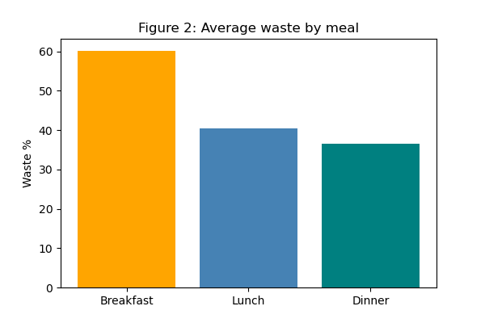
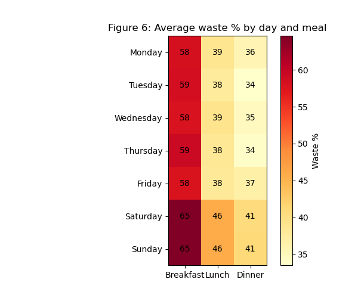
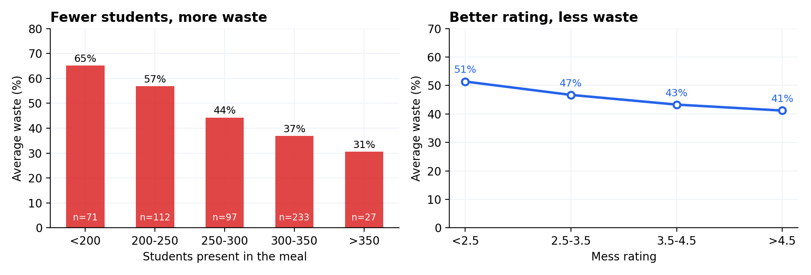

# Hostel Mess Food Waste: Data Analysis and Visualization

A Python project that simulates 180 days of a hostel mess (400 students, 3 meals a day)
and analyses when and why food is wasted.

> **Note:** the dataset is **simulated**, not collected from a real mess. The results
> show what the model assumes, not real-world evidence.

## Problem
The mess cooks for the full hostel at every meal, but fewer students turn up at
breakfast, on weekends and in exam weeks. The extra food is wasted. Nobody can see
which meals and days waste the most, so quantities are decided by guesswork.

## Approach
1. **Generate:** a stated model creates 540 records (180 days x 3 meals).
2. **Analyse:** averages, waste levels, correlation and a simple regression.
3. **Segment:** four kinds of meals, by mess rating and waste.
4. **Visualise:** figures that answer one question each.

## Dataset (`data/mess.csv`, 540 rows x 10 columns)
| Column | Meaning |
|---|---|
| date, day, meal | When the meal was served |
| is_weekend, is_exam_week | 1 if yes, else 0 |
| students_present | Students who came |
| mess_rating | Rating from 1 to 5 |
| food_cooked_kg, food_wasted_kg | Food cooked and wasted |
| waste_pct | Wasted / cooked x 100 |

## Project structure
- `programs/generate_dataset.ipynb`: builds the simulated dataset
- `programs/analyze_dataset.ipynb`: analysis and figures
- `data/mess.csv`: generated dataset
- `img/`: generated figures

## How to run
pip install numpy pandas matplotlib jupyter

Run `generate_dataset.ipynb` first, then `analyze_dataset.ipynb`.

## Key findings
- Average waste is about 46% of the food cooked.
- Breakfast wastes the most (about 60%), dinner the least (about 37%).
- Weekends and exam weeks waste more than normal days.
- Waste is strongly linked to students present (correlation about -0.95).
- Mess rating has a smaller effect (correlation about -0.25).

## Figures

## Limitations
- The data is simulated, so findings are only as good as the model's assumptions.
- Correlation does not mean causation.
- The waste levels (40% and 50%) and the segment cut-offs are my own choices.

## Author
Pankaj | Data Science, 
B.K Birla Institue of Engineering and Technology ,Pilani
